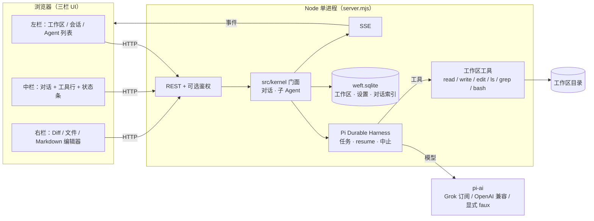

# Weft 架构

> 目标架构见 [ARCHITECTURE_V2.md](ARCHITECTURE_V2.md)，正在迁移；本文描述当前实现。

内核是 Pi Durable Harness（`@earendil-works/pi-durable`）。对话、任务、检查点、断点续跑、子 Agent、中止都走 Harness。模型调用走 `@earendil-works/pi-ai`。`server.mjs` 启动时打开 `<dataDir>/harness/session.sqlite` 并 `resume()`。没有环境变量可以切回旧的自写编排器；那个运行循环已经删除。

没有 harness id 的旧对话不出现在列表里。升级前用 `scripts/export-legacy-conversations.mjs` 把它们导出成 Markdown。

单个 Node >= 22.19 进程，浏览器通过 REST + SSE 通信。



## 关键概念
- **Agent** = 一条 Harness 对话上的运行（配置 + 检查点），可多个并行。主 Agent 的 `instructions` 为空字符串；工具是全部内置工作区工具、已启用的插件工具、`skill` 和 `delegate` / `subagent`；系统提示词的 skills section 只列启用技能的清单（名字 + 一句简介），正文由主 Agent 按需用 `skill` 工具加载。未知工具名在执行前被拒绝（`E_UNKNOWN_TOOL`），不会发出 `tool.start`。
- **多 Agent 协作**：主 Agent 用 `delegate` / `subagent` 派子 Agent，另开 Harness 对话。子 Agent 是自包含派活，不套角色模板。宿主不轮换 Agent。`GET /api/conversations/:cid` 的 `agents[]` 是主 Agent（`name: 'Agent'`）加上子 Agent 实例。演示见 [SUBAGENTS.md](SUBAGENTS.md)。
- **模型**：对话自己选的 `{ modelSourceId, modelId }`，否则 `settings.models.default`，再否则第一个可用源上的第一个模型。
- **卡住与重试**：只使用 Pi Durable 的 `stream.timeoutMs` 和 `retry`。不另写看门狗，也不在卡住时自动提交下一句。停止是 `conversation.abort(context, { background: true })`，进行中的运行和后台子 Agent 一起停。
- **工具沙箱**：所有路径解析后必须位于工作区根目录内。`write` / `edit` 的工具结果保留 `details`（path、before、after、行数），右栏 diff 从这些条目汇总：同一路径以本对话第一次改动的 before 为基线，和磁盘当前内容比较。`bash` 使用环境变量白名单、进程组 SIGKILL、1 MiB 输出上限；完整 OS 沙箱（bubblewrap）为 v1 之后的工作。
- **Skills**：`skills/<id>/SKILL.md`（前言里的 `id` / `name` / `description` + 正文）。仓库自带的 Skill 与 `$WEFT_DATA_DIR/skills` 中用户新建的 Skill 合并，同名时用户副本优先。`settings.skills[id] === false` 表示关闭，缺省为开启。主 Agent 的系统提示 skills section 只列启用技能的清单（固定首句 + 每技能一行 `- <id>: <description>`）；判断用得上时调用 `skill({ name })` 按 id（其次按 name）加载完整正文。关掉或未启用的技能不出现在清单里，工具也读不到。子 Agent 没有清单，也没有 `skill` 工具。
- **插件**：`plugins/<id>/plugin.json` 声明 `main`（插件目录内的相对 `.mjs`）和 `tools`。加载器 `import()` 该模块，并按工具名查找导出的函数。只有已开启且加载成功的工具会进入模型工具列表，并由 Harness 执行；关闭、冲突或加载失败的名字仍是 `E_UNKNOWN_TOOL`。内置工具白名单不变。导入必须指向本机目录，模块能加载才复制到数据目录；只提交名称和描述会被拒绝。相对路径先按进程工作目录解析，不存在时再按安装目录解析。`examples/plugins/` 下的示例不会自动加载。工具函数收到 `(args, ctx)`，`ctx.workspacePath` 是当前工作区。插件代码在进程内运行，没有额外沙箱。

## 耐久性设计

`src/store/sqlite.mjs` 使用 Node 22 的 `node:sqlite`（`DatabaseSync`）：

- `PRAGMA journal_mode=WAL`
- `PRAGMA busy_timeout=5000`
- `PRAGMA synchronous=NORMAL`
- `schema_version` 表 + `PRAGMA user_version`（当前为 7；迁移时递增）。启动时 `DROP TABLE IF EXISTS roles`；`conversations.role_id` 能删列就删，否则保留列但不再读写
- 数据库文件权限 `0600`。不设置 `WEFT_TOKEN` 时不写 `auth.token`
- 启动时在 `$WEFT_DATA_DIR/.lock` 上用 `O_EXCL` 抢单实例锁；若锁文件中的 pid 在 `/proc` 中仍存活则拒绝启动；进程退出时删除锁

**已知限制：** `node:sqlite` 仍带实验性警告，API 可能变化。多进程写入不受支持（靠锁文件保证单实例）。崩溃只在 e2e 层做过部分覆盖。

## 恢复不变量

对话状态、消息和 diff 都从 Harness 读。应用库只保留对话索引（工作区、标题、时间、harness id、可选的对话模型），外加一列 `last_submission_id`：每次 `submit` 返回的提交 id。读状态时用 `harness.submission(id).status()`。`queued` / `placed` 是运行中，`done` 是完成，`unanswered` 且 `reason` 为 `aborted` 是已停止，其它 `unanswered` 是失败（错误文案用这条记录的 `reason` / `detail`）。没有这个指针的对话是空闲。启动时丢掉 `events`、`messages`、`tool_calls`、`changes`、`pipelines`、`roles` 表。`conversations` 上的 `pipeline_id` / `pipeline_step` 列还在，但不再读写。

- `read` / `ls` / `grep` 可以安全重放。`write` / `edit` / `bash` 标成 unsafe：中断后不重放，模型看到 interrupted。
- 进程重启时，带 harness id 且未结束的对话由 `harness.resume()` 接着跑。状态仍是该提交重新取回的记录：还在 `placed` 就是运行中。没有 harness id 的旧行不列出、不恢复。
- 运行中发消息使用 `submit({ whenBusy: 'steer' })`，插进当前运行，模型在下一个工具回合读到。停止中止这次运行，并停掉后台子 Agent。

## Git 工作区与 worktree

`POST /api/workspaces` 支持 `{name, gitUrl, branch?}`：用 `git clone --depth 1`（`execFile`，无 shell，`--` 分隔 URL，`protocol.file.allow=never` / `protocol.ext.allow=never`）把仓库克隆到 `WEFT_DATA_DIR/workspaces/<id>/repo`。仅允许 `https:`、`ssh:` 与 `git@host:path`。存储的 `gitUrl` 会去掉 `user:pass@`。工作区记录额外字段：

```
{ source: 'local' | 'git', gitUrl, branch, rootPath, worktrees: [] }
```

本地 `path` 必须位于 `$WEFT_DATA_DIR/workspaces` 或 `$WEFT_WORKSPACE_ROOT`（默认 `$HOME/projects` 若存在，否则 `$HOME`）之下，且不得为 `/`、`$HOME` 本身、`~/.ssh`、`~/.gnupg` 或系统目录。省略 `path` 时在 data dir 下创建空仓库目录。

**TODO：git worktree 尚未实现。** `worktrees` 目前恒为空数组，预留给后续 `git worktree add`（每个对话/Agent 独立工作树、互不覆盖工作区文件）。不要在当前版本假设存在多 worktree。

## 鉴权与绑定

- 默认不鉴权。不设置 `WEFT_TOKEN` 时，`/api/*` 和 SSE 不需要 cookie、Bearer 或 ticket。服务不读取、不生成 `$WEFT_DATA_DIR/auth.token`。启动只打印 `WEFT_READY http://127.0.0.1:<port>`。浏览器打开这个地址即可使用。
- `GET /login` 在未设置 `WEFT_TOKEN` 时一律 302 到 `/`，带不带 `token` 都一样，不种 cookie。
- 设置 `WEFT_TOKEN` 后恢复可选登录：`/api/*` 必须 `Authorization: Bearer` 或 cookie `weft_token`（HttpOnly, SameSite=Strict）。`GET /login?token=` 校验通过后 Set-Cookie 并 302 `/`，令牌不对返回 401。SSE 优先 cookie；`POST /api/sse-ticket` 签发 60s 一次性 `?ticket=`。不接受长效 token 作为 query。
- 设置了 `WEFT_ALLOWED_HOSTS` 但没有 `WEFT_TOKEN` 时，启动打印一行警告：服务对这些主机开放且没有鉴权。
- 只监听 `127.0.0.1`。`Host` 必须是 `127.0.0.1:<port>` / `localhost:<port>` / `[::1]:<port>`，可用 `WEFT_ALLOWED_HOSTS` 追加，否则 400。
- 写方法要求 `Content-Type: application/json`，否则 415；若带 `Origin` 则必须同源，否则 403。这些检查在鉴权之前执行。响应带 CSP、`X-Content-Type-Options`、`Referrer-Policy`、`X-Frame-Options`。

自定义 `baseUrl` 可指向任意 OpenAI 兼容主机（openai / x.ai / deepseek / anthropic 为常见值）。更换 `baseUrl` 或 `provider` 且请求中没有新的明文 `apiKey` 时，会清空已存密钥，避免把密钥发到攻击者主机。
